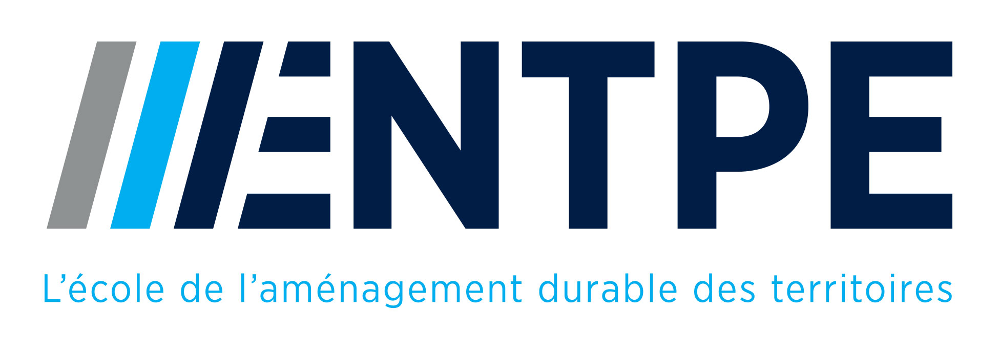
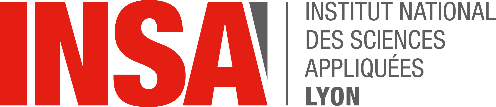
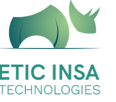
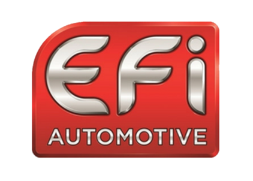

I am a Joint PhD candidate at Université de Sherbrooke (Québec, Canada), in Civil Engineering, and ENTPE (Vaulx-en-Velin, France), in Mechanical Engineering. My research focuses on numerical fluid-structure interaction, nonlinear structural dynamics and vibration control, with applications to overhead powerline structures. I hold a MEng in Mechanical Engineering from INSA Lyon and combine numerical modelling with experimental structural dynamics and wind tunnel testing.

  <a href="/files/cv.pdf" target="_blank" rel="noopener noreferrer" class="home-btn home-btn--green"><i class="fas fa-download"></i> Download CV (PDF)</a>
  <a href="/publications/" class="home-btn home-btn--blue"><i class="fas fa-book"></i> View Publications</a>

  

    <h2>Education</h2>
    <article class="resume-item">
      

        

        <h3 class="resume-item__org">Université de Sherbrooke, Canada</h3>
        
2024 – Present

      

      
Joint PhD in Civil Engineering — Numerical Fluid-Structure Interaction and Overhead Powerline Structures

    </article>
    <article class="resume-item">
      

        

        <h3 class="resume-item__org">ENTPE, France</h3>
        
2024 – Present

      

      
Joint PhD in Mechanical Engineering — Nonlinear Structural Dynamics and Vibration Control

    </article>
    <article class="resume-item">
      

        

        <h3 class="resume-item__org">INSA Lyon, France</h3>
        
2021 – 2024

      

      
MEng in Mechanical Engineering — Product Design and Innovation

    </article>
  

  

    <h2>Experience</h2>
    <article class="resume-item">
      

        

        <h3 class="resume-item__org">ETIC INSA Technologies, Lyon, France</h3>
        
Aug 2023 – Jul 2024

      

      
Consulting Engineer, Fluid-Structure Interaction

      
<em>Activities:</em> CFD Modelling, Experimental Characterization of Composite Materials, Finite Element Modelling

    </article>
    <article class="resume-item">
      

        

        <h3 class="resume-item__org">Institute for Mechatronic Systems (IMS), Darmstadt, Germany</h3>
        
Jul 2023 – Oct 2023

      

      
Research Intern, Vehicle Dynamics Team

      
<em>Activities:</em> Product Design, Reverse Engineering, Numerical Modelling

    </article>
    <article class="resume-item">
      

        

        <h3 class="resume-item__org">EFI Automotive, Saint-Maurice-de-Beynost, France</h3>
        
2021 – 2024

      

      
R&amp;D Mechanical Design Engineer (Apprenticeship), Advanced Research Team

      
<em>Activities:</em> Product Design, Benchmarking, Reverse Engineering, System Modelling, Prototyping and Testing

    </article>
  

  <h2>Skills</h2>
  

    

      <h3>Mechanical Design &amp; Manufacturing</h3>
      
CAD (SolidWorks, CATIA V5, Creo, 3DEXPERIENCE), GD&amp;T (CETOL, 3DCS), CAM (TopSolid, Esprit), PLM

    

    

      <h3>Structural Modelling &amp; Simulation</h3>
      
Linear and Nonlinear Finite Element Modelling (Abaqus, Code_Aster), CFD (Ansys Fluent, STAR-CCM+), Gmsh, MSC Adams, Simulink

    

    

      <h3>Experimental Skills</h3>
      
Experimental Structural Dynamics, Experimental Acoustics, Wind Tunnel Testing

    

    

      <h3>Programming</h3>
      
Python, MATLAB, VBA

    

    

      <h3>Communication</h3>
      
Scientific Outreach, Poster Presentations, Scientific Presentations

    

  

